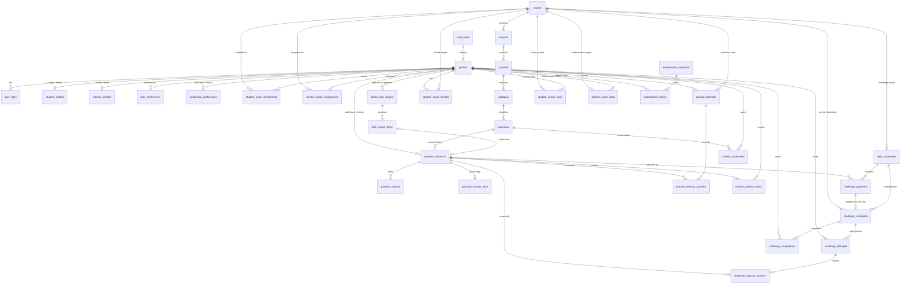

# Database Architecture

## Scope and conventions

This document proposes a PostgreSQL relational schema for the Northstar competitive-exam platform's existing frontend features: role-based workspaces, exam content authoring, practice, daily challenges, student performance, bookmarks and mistakes, analytics, leaderboard, and settings. It is an architecture proposal only; it does not provision Supabase, create tables, or change the frontend.

- Use Supabase Auth as the identity provider. `auth.users` is managed by Supabase; the application-owned `public.profiles` row extends it.
- Use `uuid` primary keys generated by PostgreSQL (`gen_random_uuid()`); retain human-readable student/teacher codes only as unique display identifiers.
- Use `timestamptz` for instants, stored in UTC, with `created_at` and `updated_at` consistently named. An update trigger maintains `updated_at`.
- Use `date` only for calendar dates. Daily challenge dates are defined in `Asia/Kolkata`; calculate the date on trusted server/database code and store the resulting local date explicitly. Store opening and closing instants as `timestamptz`.
- Use foreign keys, `NOT NULL`, `UNIQUE`, and `CHECK` constraints for invariants. Index foreign-key columns used for joins and RLS filters; PostgreSQL does not automatically index referencing columns.
- Keep source events (answers, attempts, completions) authoritative. Analytics and leaderboard tables are rebuildable caches, not independent sources of truth.
- Map the UI labels `KCET`, `NEET`, and `JEE Main` to stable exam codes such as `KCET`, `NEET`, and `JEE_MAIN`.

## Entity relationship diagram

`auth_users` below represents Supabase's existing `auth.users` table; it is not an application table. The answer-key entity belongs in a non-exposed schema such as `private`.

## Table design

The columns below describe the proposed minimum useful model; audit fields such as `created_at` and `updated_at` are omitted from some rows for readability.

### Identity, roles, and preferences

| Table | Important columns and constraints |
|---|---|
| `public.profiles` | `id uuid PK REFERENCES auth.users(id) ON DELETE CASCADE`; `display_name`; `phone_e164` nullable; `avatar_path` nullable; `account_status` (`active`, `inactive`, `suspended`); timestamps. Do not copy the password or maintain a second editable email. Read email from Auth in trusted server code. |
| `public.user_roles` | `user_id FK profiles`; `role` (`admin`, `teacher`, `student`); `granted_by FK profiles` nullable for bootstrap; `granted_at`; composite PK `(user_id, role)`. Supports a user having more than one role without embedding authorization in a client-editable profile field. |
| `public.student_profiles` | `user_id PK/FK profiles`; `student_code UNIQUE NOT NULL`; optional `school_name`, `class_level`; `leaderboard_opt_in boolean NOT NULL DEFAULT true`; timestamps. Avoid collecting date of birth or other unnecessary personal data. |
| `public.teacher_profiles` | `user_id PK/FK profiles`; `teacher_code UNIQUE NOT NULL`; optional `bio`; timestamps. |
| `public.student_exam_enrollments` | `student_user_id FK student_profiles`; `exam_id FK exams`; `status`; `enrolled_at`; composite PK `(student_user_id, exam_id)`. |
| `public.teacher_exam_assignments` | `teacher_user_id FK teacher_profiles`; `exam_id FK exams`; `assigned_by FK profiles`; `assigned_at`; composite PK `(teacher_user_id, exam_id)`. This is the read scope for teachers' published content and answer-key access; it grants no content write privileges. |
| `public.user_preferences` | `user_id PK/FK profiles`; `theme` (`light`, `dark`); `language_code`; `time_zone`; `date_format`; `updated_at`. User-editable preferences only. |
| `public.notification_preferences` | `user_id FK profiles`; `notification_key`; `enabled`; composite PK `(user_id, notification_key)`. Do not store notification delivery secrets here. |
| `public.platform_settings` | Singleton row (`id` constrained to `1`); website name, description, logo storage path, default language, time zone, date format, `updated_by FK profiles`, timestamps. Admin-only access. |

`profiles.account_status` is the canonical active/inactive state for both students and teachers. Do not duplicate it in their role-specific detail tables.

### Exam content and protected answer keys

| Table | Important columns and constraints |
|---|---|
| `public.exams` | `id uuid PK`; `code UNIQUE` (for example `JEE_MAIN`); `name`; `is_active`; timestamps. |
| `public.subjects` | `id PK`; `exam_id FK exams`; `name`; `sort_order`; `is_active`; `UNIQUE (exam_id, name)`. |
| `public.chapters` | `id PK`; `subject_id FK subjects`; `name`; `chapter_number`; `sort_order`; `is_active`; unique chapter number/name within a subject. |
| `public.subtopics` | `id PK`; `chapter_id FK chapters`; `name`; `sort_order`; `is_active`; `UNIQUE (chapter_id, name)`. |
| `public.questions` | Stable logical question `id PK`; `subtopic_id FK subtopics`; `created_at`; `archived_at` nullable. Exam and subject are obtained through the subtopic/chapter hierarchy, avoiding duplicated hierarchy IDs. Archive instead of deleting content referenced by attempts. |
| `public.question_revisions` | `id PK`; `question_id FK questions`; `revision_number`; `prompt`; `question_type`; `difficulty`; `status` (`draft`, `in_review`, `published`, `superseded`); `created_by FK profiles`; `reviewed_by FK profiles` nullable; `published_at`; timestamps; `UNIQUE (question_id, revision_number)`. Only admins create, edit, review, or publish revisions. Published revisions are immutable; edits create a new revision. |
| `public.question_options` | `id PK`; `question_revision_id FK question_revisions`; `option_key`; `body`; `sort_order`; `UNIQUE (question_revision_id, option_key)` and `UNIQUE (question_revision_id, id)` for composite references. Contains no correctness flag. |
| `private.question_answer_keys` | `question_revision_id PK/FK question_revisions`; `correct_option_id`; `explanation`; `updated_at`; composite FK `(question_revision_id, correct_option_id)` to the matching option. This ensures the correct option belongs to that exact revision. The schema must not be exposed through the Supabase API. |

Each published revision must have the required number of options and exactly one valid answer key. Enforce this in a trusted publishing function/transaction; ordinary row-level `CHECK` constraints cannot validate counts across rows. Student-facing reads should use a safe view or endpoint exposing published prompts/options only. Attempts reference the immutable revision so later edits do not change historical grading.

### Admin bulk question imports

| Table | Important columns and constraints |
|---|---|
| `public.admin_bulk_imports` | `id uuid PK`; `uploaded_by FK profiles`; `source_format` constrained to `xls`, `xlsx`, `csv`, `doc`, `docx`, or `pdf`; `original_file_name`; private `storage_object_path`; `content_type`; `file_size_bytes`; optional `checksum_sha256`; `status` (`uploaded`, `queued`, `processing`, `needs_review`, `approved`, `imported`, `failed`, `cancelled`); `processing_errors jsonb`; item counters; `processing_started_at`, `processing_finished_at`; `approved_by FK profiles` and `approved_at`; timestamps. |
| `public.bulk_import_items` | `id uuid PK`; `import_id FK admin_bulk_imports`; `item_index` and optional source locator (row/page); `status` (`parsed`, `valid`, `invalid`, `approved`, `rejected`, `imported`); normalized `question_preview jsonb` including prompt, options, answer and explanation; `validation_errors jsonb`; `approved_by FK profiles` and `approved_at`; nullable `imported_revision_id FK question_revisions UNIQUE`; `imported_at`; `UNIQUE (import_id, item_index)`. The staged answer and explanation are admin-only until approved and written to `private.question_answer_keys`. |

Store source files in a private Supabase Storage bucket with an opaque object path; retain the original filename, format, MIME type, size, and optional checksum as metadata. A trusted processor parses the supported Excel, CSV, Word, and PDF formats and records per-file processing errors plus per-question previews and validation errors. Admins can inspect previews, correct or reject invalid items, and approve valid questions. Approval and creation of the question revision/options/private answer key should be transactional; successful items record their imported revision and timestamp, and the parent import reaches `imported` when processing is complete. Imports and previews are never exposed to students or teachers.

Only an authenticated Admin may upload, inspect, retry, cancel, edit staged previews, or approve imports. RLS should enforce this on both import tables, with narrowly scoped trusted processor functions allowed to update parsing status/results but not to approve content. Storage policies must use the same Admin-only boundary. Imported content follows the same Admin-only authoring and publication rules as manually managed questions.

### Daily challenges and exam-specific streaks

| Table | Important columns and constraints |
|---|---|
| `public.daily_challenges` | `id PK`; `exam_id FK exams`; `title`; `status` (`draft`, `scheduled`, `published`, `completed`, `archived`); `created_by FK profiles`; timestamps; `UNIQUE (id, exam_id)` to support schedule integrity. |
| `public.challenge_questions` | `id PK`; `challenge_id FK daily_challenges`; `question_revision_id FK question_revisions`; `position`; `UNIQUE (challenge_id, position)` and `UNIQUE (challenge_id, question_revision_id)`. A challenge must contain 30 distinct logical questions before scheduling. Store the selected revision, not a mutable question reference. |
| `public.challenge_schedules` | `id PK`; `challenge_id`; `exam_id`; required `challenge_question_id` FK to a question in the same challenge, unique across schedules; `challenge_date date` in `Asia/Kolkata`; `opens_at`, `closes_at timestamptz`; `UNIQUE (exam_id, challenge_date)`; composite FK `(challenge_id, exam_id)` to `daily_challenges`. A scheduled challenge has 30 schedule rows, one distinct question per local day; the deadline is the following local midnight (11:59 PM inclusive). |
| `public.challenge_attempts` | `id PK`; `schedule_id FK challenge_schedules`; `student_user_id FK student_profiles`; server-assigned `attempt_number`; `status` (`submitted` for each response); `started_at`, `submitted_at`; server-calculated `correct_count`; `UNIQUE (student_user_id, schedule_id, attempt_number)`. Wrong answers create retry attempts until that schedule's deadline; a correct answer prevents further attempts. |
| `public.challenge_attempt_answers` | `id PK`; `attempt_id FK challenge_attempts`; `challenge_question_id FK challenge_questions`; required `selected_option_id`; server-assigned `is_correct`; `answered_at`; `UNIQUE (attempt_id, challenge_question_id)`. The submission RPC derives the question only from that day's schedule, verifies option membership, and grades against the private answer key. |
| `public.challenge_completions` | `student_user_id`; `schedule_id`; `attempt_id UNIQUE FK challenge_attempts`; `completed_at`; score fields (`score` and `total_questions` are both 1 for a daily schedule); composite PK `(student_user_id, schedule_id)`. One authoritative completion per student and scheduled day. |
| `public.student_exam_streaks` | `student_user_id FK student_profiles`; `exam_id FK exams`; `current_days`; `best_days`; `last_completed_date date`; `updated_at`; composite PK `(student_user_id, exam_id)`. A derived cache rebuilt from `challenge_completions`, maintained transactionally with completion. |

Generate and compare `challenge_date` using `Asia/Kolkata`, not the browser's local zone. Keep `opens_at` and `closes_at` as absolute instants and validate the submission window server-side. A student can have separate streak rows for KCET, NEET, and JEE Main.

### Practice, bookmarks, mistakes, and reporting

| Table | Important columns and constraints |
|---|---|
| `public.practice_attempts` | `id PK`; `student_user_id FK student_profiles`; `exam_id FK exams`; `status`; `started_at`, `finished_at`; timestamps. One row represents a practice session. |
| `public.practice_attempt_answers` | `id PK`; `practice_attempt_id FK practice_attempts`; `question_revision_id FK question_revisions`; `selected_option_id` nullable; server-assigned `is_correct`; `answered_at`; `UNIQUE (practice_attempt_id, question_revision_id)`. Composite FK from revision/option prevents selecting an option from another question. New sessions preserve retries/history. |
| `public.student_bookmarks` | `student_user_id FK student_profiles`; `question_id FK questions`; `created_at`; composite PK `(student_user_id, question_id)`. Bookmarks follow the logical question to its current published revision. |
| `public.student_mistake_items` | `id PK`; `student_user_id FK student_profiles`; `question_revision_id FK question_revisions`; `first_mistaken_at`; `last_mistaken_at`; `last_wrong_answer_id FK practice_attempt_answers` nullable; optional private note; `reviewed_at` nullable; `UNIQUE (student_user_id, question_revision_id)`. Store a reference to the source answer rather than copying the student's response. |
| `public.student_activity_daily` | `student_user_id FK student_profiles`; `exam_id FK exams`; `activity_date date` in `Asia/Kolkata`; cached practice counts, correct counts, challenge completions, and active minutes; composite PK `(student_user_id, exam_id, activity_date)`. Rebuildable from source events. |
| `public.student_exam_stats` | `student_user_id FK student_profiles`; `exam_id FK exams`; lifetime/period attempt and correct counts; `calculated_at`; composite PK `(student_user_id, exam_id)`. Accuracy is derived as `correct / attempted` (zero attempts yields no accuracy), not independently edited. Rebuildable. |
| `public.leaderboard_snapshots` | `id PK`; nullable `exam_id FK exams` (`NULL` means all exams); `period` (`daily`, `weekly`, `monthly`, `all_time`); `period_start`, `period_end` as Kolkata calendar dates; `generated_at`. Use partial unique indexes to prevent duplicate snapshots for the same period/exam, including the `NULL` all-exams scope. |
| `public.leaderboard_entries` | `snapshot_id FK leaderboard_snapshots`; `student_user_id FK student_profiles`; `rank`; points, question and correct counts, accuracy numerator/denominator, streak; composite PK `(snapshot_id, student_user_id)` and `UNIQUE (snapshot_id, rank)`. Rebuild from validated attempts/completions. Public reads return only opted-in display aliases and leaderboard metrics. |

Activity and performance rollups make dashboard queries efficient but must be updated by trusted database functions/jobs and reconciled from source attempts. Do not accept client-supplied scores, accuracy, correctness, streaks, ranks, or aggregate counts.

### Relationships and deletion policy

- Each Supabase Auth identity has one profile; the profile can have one student profile, one teacher profile, or both, with access determined by `user_roles`.
- Exam content follows `exam → subject → chapter → subtopic → question → revision → options`. One revision can be assigned to multiple challenge schedules and referenced by many practice/challenge answers.
- Students and teachers connect to exams through enrollment/assignment junction tables. This supports multiple exam registrations without comma-separated values or duplicate profile rows.
- Challenge definitions are separate from schedules. A challenge can be scheduled on different Kolkata dates, while each exam has at most one schedule per local date.
- Source attempts and completions feed streaks, activity/performance rollups, and leaderboard snapshots. Rebuild derived data if calculations or rules change.
- Use `RESTRICT` for deleting content that has attempts or schedules; archive questions and exams instead. User-owned personal data can be removed via a deliberate account-deletion workflow. Set authorship references to `NULL` when retaining content after an account is removed. Choose cascades explicitly per table and applicable retention requirements.

## Constraints and indexes

Apply database constraints for all uniqueness and domain invariants, including:

- Unique exam codes; unique subject names per exam; unique chapter numbers/names per subject; unique subtopic names per chapter.
- Unique role grants, exam enrollments/assignments, per-session question answers, bookmarks, and student completion per schedule.
- Unique import item positions per file; constrain formats/statuses, non-negative file sizes and counters, and imported revision references. Index imports by uploader/status/time and items by `(import_id, item_index)` and status.
- Non-negative positions, attempt numbers, counts, and scores; `opens_at < closes_at`; valid revision, attempt, and account statuses.
- Composite foreign keys for selected options so an answer cannot point to an option from a different revision.
- Only a trusted publish/submit function can transition questions to published or set correctness/score fields.

Create indexes for:

- Every frequently joined FK, especially profile ownership, hierarchy IDs, exam IDs, and revision IDs.
- `question_revisions (status, question_id)` with a partial index for `status = 'published'`; optional GIN full-text index on published prompts for question search.
- `practice_attempts (student_user_id, started_at DESC)` and `practice_attempt_answers (question_revision_id, answered_at DESC)`.
- `student_mistake_items (student_user_id, last_mistaken_at DESC)` and bookmark ownership/list ordering.
- `challenge_schedules (exam_id, challenge_date)` unique; attempts by `(student_user_id, schedule_id)`; completions by `(student_user_id, completed_at DESC)`.
- Activity/stat primary keys for student/exam/date retrieval; leaderboard entries by `(snapshot_id, rank)` and unique `(snapshot_id, student_user_id)`.

Avoid indexing every column by default. Check actual query plans and workload after implementation.

## Security architecture for Supabase

### Roles and access boundaries

| Actor | Intended permissions |
|---|---|
| Anonymous | Read only explicitly public catalog data and published question prompts/options if the product allows logged-out browsing. No profiles, attempts, answer keys, or leaderboard identities. |
| Student | Read/update a limited allowlist of their own profile and preferences; read their enrolled exams and published content; create/read their own attempts, bookmarks, mistake items, and challenge records. Cannot change role, account status, score, correctness, streak, or another student's data. |
| Teacher | Read own profile and assigned exam catalog; read published question prompts/options and the corresponding correct answers/explanations only for assigned exams through a read-only, authorization-checked endpoint. No question create, edit, delete, review, or publish permissions; no student PII or import access. |
| Admin | Manage profiles, role grants, assignments, catalog, question creation/editing/review/publication, bulk imports and approvals, challenge scheduling, and platform settings through authenticated admin operations. Sensitive actions should be audited. |
| Trusted server/database functions | Validate answers, update completion/streak/rollups, publish content, and create leaderboard snapshots. Use narrowly scoped functions rather than exposing privileged table access to the browser. |

### Registration, profile provisioning, and post-login routing

- On every Supabase Auth user insert, a database trigger creates the matching `public.profiles` row using `auth.users.id` as the profile primary/foreign key. It may copy validated display-name data, but must ignore user-supplied role, account-status, and privilege fields. Provisioning must be idempotent and failures must be surfaced/retried rather than leaving an account silently usable without a profile.
- Public registration is student-only. After Auth creates the identity, trusted server/database logic creates the `student_profiles` row and grants the `student` role. It must not read a requested role from form data, query parameters, or user-editable Auth metadata. Exam selections, if accepted during registration, are validated and saved as enrollments; they do not grant privileges.
- Admin and Teacher accounts are created or authorized only through an Admin-controlled server workflow. That workflow verifies the acting Admin, provisions the Auth identity/profile, and grants the intended role through a protected function. Public signup cannot request, promote to, or self-assign either role. Role-grant functions are not executable by `anon` or ordinary users.
- After login, server-side code verifies the Supabase session, reads `profiles.account_status` and `user_roles`, then redirects an active user to the dashboard allowed by their granted role (`/admin`, `/teacher`, or `/dashboard`). If multiple roles are granted, show a role chooser limited to those database grants or use a stored preference only after checking it against current grants. Missing roles or inactive/suspended profiles are denied access. Client-side redirects are UX only; every route/API and RLS policy must independently authorize the request.

### RLS and application enforcement

1. Enable RLS on every exposed application table. Add explicit policies; absence of a policy must mean denial. Apply ownership policies using `auth.uid()` and `student_user_id`/`user_id`.
2. Implement role checks in a small `SECURITY DEFINER` helper, if used, with a fixed safe `search_path`, schema-qualified references, minimal `EXECUTE` grants, and no recursion through policies. Do not trust a role string supplied by the client or UI.
3. Teachers have `SELECT` access only to published question metadata, revisions, and options within their assigned exams. Provide corresponding correct answers/explanations through a read-only server/RPC endpoint that verifies the teacher role, assigned exam, and published status on every request. Deny teachers all question/revision/option writes and all review, delete, and publication operations.
4. Admin-only policies govern question authoring/review/publication and both bulk-import tables. Enforce uploader and approver identity and allowed import/item state transitions in trusted operations. A processor may write parse results only through a narrow internal function; it cannot approve imports or publish questions.
5. Do not allow direct client `INSERT`, `UPDATE`, or `DELETE` on `user_roles`, `profiles.account_status`, correctness/score columns, streaks, rollups, or leaderboard cache tables. Grant/revoke roles only through trusted registration or Admin-controlled provisioning functions; protect initial Admin bootstrap outside public sign-up.
6. Keep `private` out of Supabase's exposed schemas and revoke direct table privileges on `private.question_answer_keys` from `anon` and `authenticated`. Do not expose a correctness field in public options. The teacher read endpoint must explicitly authorize the assigned exam before returning a key; students receive answer feedback only through the validated submission flow.
7. RLS exposes only today's assigned challenge question to a student. Submit daily-challenge answers only through the authenticated grading RPC. It derives the single assigned question from today's schedule, verifies `auth.uid()`, student role, enrollment, publication, option membership, and the deadline (11:59 PM Asia/Kolkata), then grades against the private key and writes the answer, attempt, completion, and streak transactionally. Wrong answers may be retried before the deadline; a correct answer completes that day. Never ship service-role credentials to the client.
8. Use `SECURITY INVOKER` safe views where possible so RLS continues to apply. If a security-definer endpoint is necessary, validate caller identity and authorization inside the function and return a minimal explicit column set.

### Personal data and storage

- Keep email in Supabase Auth; keep profile phone, avatar path, and administrative contact data behind owner/admin policies. Do not return email or phone in leaderboard responses.
- Student leaderboards use an opt-in public display name or alias and aggregate scores only. Provide a way to opt out.
- Store avatars/logos in Supabase Storage with explicit bucket policies. Prefer private buckets and signed URLs for personal images; never store raw image bytes in profile rows.
- Collect only fields the UI needs. Define retention, account deletion/anonymization, export, and backup policies before production use; follow applicable privacy and education-data requirements.
- Use append-only audit events for role changes, account status changes, question publication, and admin actions if operational accountability is required.

## Proposed structure summary

The schema separates Supabase identities from application profiles and role grants; normalizes exam content into a hierarchy with immutable question revisions; isolates answer keys in a non-exposed schema; and models Admin-controlled bulk import staging, daily schedules, attempts, completions, and exam-specific streaks independently. Public registration receives only the student role through trusted logic; Admin and Teacher roles require Admin-controlled provisioning. Teachers have assigned-exam read access to published questions and protected answers/explanations, but no authoring or review permissions. Practice answers, bookmarks, and mistake references remain student-owned. Activity, performance, and leaderboard tables are derived caches. RLS and trusted server-side workflows protect profiles, role grants, imports, and grading. Daily business dates use `Asia/Kolkata`; timestamps remain UTC.
